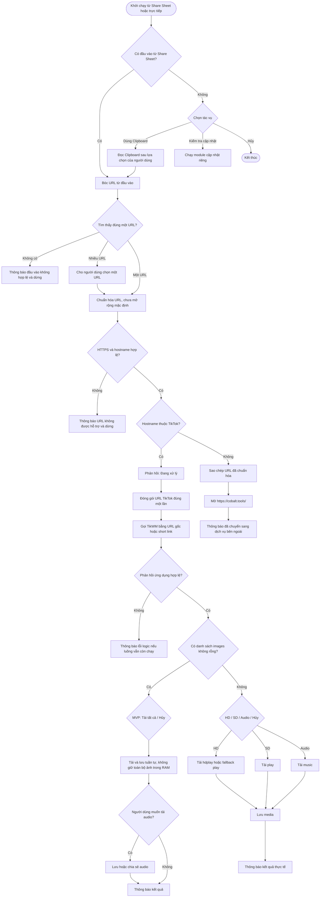

# SNVideo — Đặc tả kỹ thuật cho iOS Shortcuts

> **Trạng thái:** POC video TikTok đã chạy trên iPhone; đang gia cố để triển khai MVP  
> **Phiên bản đặc tả:** `1.3.0-implementation-draft`  
> **Ngày cập nhật:** 2026-11-19  
> **Mô hình dự án:** Cá nhân, mã nguồn mở, không vận hành backend riêng

SNVideo là một iOS Shortcut hỗ trợ nhận liên kết từ Share Sheet hoặc Clipboard, tải nội dung TikTok thông qua TikWM, và chuyển các nền tảng không được xử lý trực tiếp sang Cobalt. Tài liệu này là nguồn tham chiếu chính cho phạm vi, kiến trúc, quy tắc xử lý, rủi ro và tiêu chí nghiệm thu trước khi lắp ráp Shortcut thật.

> [!IMPORTANT]
> SNVideo chỉ điều phối tác vụ trên thiết bị. URL và thông tin kết nối của người dùng vẫn được gửi đến các dịch vụ bên thứ ba như TikWM, Cobalt, GitHub và máy chủ chứa media. “Không có backend riêng” không đồng nghĩa với “không gửi dữ liệu ra ngoài”.

### Trạng thái thực nghiệm hiện tại

Đã xác nhận trên iPhone thật qua TikTok Share Sheet:

- action **Lấy URL từ Đầu vào phím tắt** bóc đúng short link `https://vt.tiktok.com/...`;
- POC ban đầu gửi trực tiếp short link đến TikWM thành công; lần chạy hiện tại nhận application soft error, nên build chẩn đoán mở rộng có điều kiện `vt.tiktok.com`/`vm.tiktok.com` trước khi gọi API và vẫn cần xác minh lại trên iPhone;
- TikWM trả JSON với `code = 0` và các khóa quan sát được gồm `title`, `hdplay`, `play`, `music_info`;
- URL `hdplay` tải được video MP4 không logo;
- iOS hỏi quyền kết nối đến CDN ở lần đầu trên thiết bị thử nghiệm;
- action **Lưu vào album ảnh** lưu thành công video vào Photos/Recents;
- thời gian xử lý quan sát được khoảng 2–4 giây trong ca thử thành công.

Phạm vi bằng chứng trên chỉ xác nhận **đường POC video có `hdplay`**. Chưa xem là hoàn tất toàn bộ Gate A/B vì các trường hợp thiếu HD, slideshow, audio, hostname routing, Clipboard và lỗi mạng chưa được kiểm chứng đầy đủ.

---

## 1. Mục tiêu và giới hạn

### 1.1. Mục tiêu MVP

Phiên bản đầu tiên phải thực hiện ổn định các tác vụ sau:

1. Nhận một URL từ Share Sheet hoặc Clipboard.
2. Bóc URL khỏi đoạn văn bản chia sẻ, giữ short link hợp lệ làm đầu vào chính và không tự động mở rộng URL trong MVP.
3. Xác thực URL trước khi gửi đến dịch vụ bên thứ ba.
4. Với TikTok:
   - tải video HD không logo khi `hdplay` hợp lệ;
   - tự động dùng `play` nếu không có `hdplay`;
   - cho phép tải video SD;
   - cho phép lưu âm thanh sau khi xác minh đúng URL/định dạng;
   - nhận diện Photo Slideshow trước khi đọc `hdplay`/`play`;
   - ở MVP đầu tiên, cho phép tải toàn bộ album tuần tự hoặc hủy; các chế độ duyệt/chọn lẻ được bổ sung sau khi Gate C đạt.
5. Với nền tảng khác:
   - sao chép URL đã chuẩn hóa;
   - mở trang Cobalt để người dùng tự tiếp tục.
6. Hiển thị phản hồi bắt đầu xử lý và thông báo rõ khi hoàn thành, bị hủy hoặc gặp application soft error, tránh người dùng bấm lặp trong khoảng chờ 2–4 giây.
7. Không yêu cầu VPS, database hoặc API do dự án tự vận hành.

### 1.2. Ngoài phạm vi MVP

Các chức năng sau chưa được cam kết trong phiên bản đầu tiên:

- Tự phân tích trực tiếp Facebook, Instagram, YouTube hoặc mọi nền tảng khác.
- Tải hàng loạt nhiều bài đăng trong một lần chạy.
- Chạy nền lâu dài hoặc tiếp tục tải sau khi iOS đóng Shortcut.
- Đảm bảo TikWM/Cobalt luôn sẵn sàng hoặc luôn miễn phí.
- Vượt giới hạn truy cập, CAPTCHA, nội dung riêng tư hoặc cơ chế bảo vệ của nền tảng.
- Tự động cập nhật Shortcut mà không có xác nhận của người dùng.
- Đồng bộ cấu hình giữa nhiều thiết bị.
- Phân tích hoặc xử lý media nặng ngay trên thiết bị.

### 1.3. Tiêu chí thiết kế

Theo thứ tự ưu tiên:

1. **Không làm mất kiểm soát của người dùng.** Mọi lựa chọn tải và cập nhật đều có xác nhận rõ ràng.
2. **Luồng tải chính không phụ thuộc GitHub.** Lỗi kiểm tra cập nhật không được ngăn việc tải media.
3. **Thất bại có thông báo.** Không báo thành công khi tải hoặc lưu chưa hoàn tất.
4. **Giảm dữ liệu gửi cho bên thứ ba.** Chỉ gửi URL cần thiết đến dịch vụ tương ứng.
5. **Ưu tiên khả năng bảo trì hơn số lượng tính năng.** Không thêm nền tảng nếu chưa có kiểm thử và phương án lỗi.

---

## 2. Kiến trúc và ranh giới tin cậy

### 2.1. Thành phần

| Thành phần | Vai trò | Dự án kiểm soát? | Có thể làm luồng thất bại? |
|---|---|---:|---:|
| iOS Shortcuts | Điều phối đầu vào, menu, tải và lưu | Có | Có |
| TikWM | Phân tích URL TikTok và trả URL media | Không | Có |
| Cobalt | Giao diện tải thủ công cho nền tảng khác | Không | Có |
| GitHub Raw | Phân phối `manifest.json` | Một phần | Không được phép ảnh hưởng luồng tải MVP |
| iCloud Shortcuts | Chia sẻ phiên bản Shortcut | Không | Chỉ ảnh hưởng cập nhật/cài đặt |
| CDN/media host | Cung cấp file video, ảnh hoặc audio | Không | Có |

### 2.2. Nguyên tắc “không backend riêng”

- SNVideo không vận hành server trung chuyển media.
- Shortcut gọi trực tiếp dịch vụ bên thứ ba từ thiết bị người dùng.
- Mục tiêu chi phí là **không phát sinh chi phí hạ tầng do dự án quản lý**, không phải cam kết mọi dịch vụ bên thứ ba sẽ luôn miễn phí.
- Dịch vụ bên thứ ba là phụ thuộc không có SLA; cấu trúc phản hồi, domain hoặc chính sách có thể thay đổi bất kỳ lúc nào.

### 2.3. Mô hình quyền riêng tư

Khi sử dụng SNVideo, bên thứ ba có thể nhận:

- URL bài đăng mà người dùng yêu cầu xử lý;
- địa chỉ IP, thời điểm truy cập và metadata mạng;
- User-Agent hoặc thông tin request do iOS gửi;
- dữ liệu cần thiết để trả media.

SNVideo không được tuyên bố “hoàn toàn riêng tư” hoặc “xử lý 100% nội bộ”. Mô tả chính xác là:

> SNVideo không gửi dữ liệu qua máy chủ do dự án vận hành. Dữ liệu được gửi trực tiếp từ thiết bị đến các dịch vụ cần thiết để thực hiện yêu cầu.

---

## 3. Luồng dữ liệu chuẩn

Kiểm tra cập nhật không nằm trong đường tải chính của MVP.



---

## 4. Hợp đồng đầu vào và chuẩn hóa URL

### 4.1. Nguồn đầu vào

Shortcut nhận:

- `URL` và `Văn bản` từ Share Sheet;
- Clipboard khi chạy trực tiếp và không có Shortcut Input.

Thiết lập Share Sheet phải được ghi lại khi triển khai:

- bật **Hiển thị trong Bảng chia sẻ**;
- chỉ nhận loại dữ liệu `URL` và `Text` trong MVP;
- không giả định mọi ứng dụng đều trả một đối tượng URL chuẩn.

### 4.2. Quy tắc bóc URL và Clipboard

1. Ưu tiên URL lấy từ Shortcut Input; Share Sheet là luồng sử dụng chính được khuyến nghị.
2. Nếu Shortcut Input trống, hiển thị menu trước khi truy cập Clipboard:
   - `Dùng liên kết trong Clipboard`
   - `Kiểm tra cập nhật`
   - `Hủy`
3. Chỉ đọc Clipboard sau khi người dùng chủ động chọn `Dùng liên kết trong Clipboard`. iOS vẫn có thể hiển thị yêu cầu cấp quyền dán; menu này giúp hành vi không xảy ra bất ngờ nhưng không bảo đảm loại bỏ popup hệ thống.
4. Dùng action lấy URL từ đầu vào thay vì coi toàn bộ văn bản là URL.
5. Không có URL: thông báo lỗi và dừng.
6. Có nhiều URL: hiển thị danh sách để người dùng chọn một URL; không tự chọn URL đầu tiên trong bản phát hành công khai.
7. Người dùng hủy chọn hoặc từ chối quyền Clipboard: kết thúc yên lặng hoặc hướng dẫn dùng Share Sheet; không coi là lỗi hệ thống.

### 4.3. Chuẩn hóa, short link và query encoding

`Clean_URL` phải trải qua các bước:

1. Loại khoảng trắng và ký tự xuống dòng ở đầu/cuối.
2. Module đầu vào không mở rộng URL. Ngay trước TikWM, chỉ hostname chính xác `vt.tiktok.com` hoặc `vm.tiktok.com` mới chạy `Expand URL`; URL TikTok đầy đủ không chạy action này.
3. Chỉ chấp nhận scheme `https` trong MVP.
4. Tách hostname và chuyển thành chữ thường.
5. Bỏ fragment `#...` nếu prototype xác minh fragment không cần cho nội dung.
6. Giữ query parameter khi chưa chứng minh rằng việc loại bỏ không làm hỏng liên kết.
7. Chèn URL TikTok vào tham số `url` bằng cơ chế encode đúng **một tầng**.
8. Sau khi mở rộng short link, xác thực URL đích vẫn dùng HTTPS và hostname bằng `tiktok.com` hoặc kết thúc chính xác bằng `.tiktok.com`; nếu không đạt thì dừng trước TikWM. Action này có thể gây system hard error và hành vi phải được kiểm thử trên iPhone.

Không nối trực tiếp URL thô chứa `?` hoặc `&` theo dạng:

```text
https://www.tikwm.com/api/?url=<Clean_URL>&hd=1
```

Ví dụ URL bên trong:

```text
https://www.tiktok.com/@user/video/123?_t=abc&_r=1
```

Khi là giá trị của query parameter `url`, các ký tự phân tách của URL bên trong phải được encode để `&_r=1` không bị hiểu nhầm thành tham số của TikWM:

```text
https://www.tikwm.com/api/?url=https%3A%2F%2Fwww.tiktok.com%2F%40user%2Fvideo%2F123%3F_t%3Dabc%26_r%3D1&hd=1
```

Quy tắc chống double encoding:

- Nếu action xây dựng query parameter đã tự encode giá trị, không encode thủ công lần nữa.
- Nếu tự tạo `Encoded_URL`, không đưa nó qua một bước URL builder tiếp tục encode dấu `%` thành `%25` thêm lần nữa.
- Phải kiểm tra URL request cuối cùng trong prototype, không chỉ kiểm tra biến trung gian.
- So sánh raw/encoded chỉ là test tương thích TikWM; không chọn cách nối URL thô làm thiết kế mặc định.

### 4.4. Nhận diện TikTok

Không dùng riêng điều kiện `Clean_URL chứa tiktok.com`. Chỉ coi là TikTok nếu hostname:

- bằng `tiktok.com`; hoặc
- kết thúc chính xác bằng `.tiktok.com`.

Ví dụ hợp lệ:

- `www.tiktok.com`
- `m.tiktok.com`
- `vt.tiktok.com`
- `vm.tiktok.com`

Ví dụ không hợp lệ:

- `tiktok.com.example.org`
- `example.org/?next=tiktok.com`
- `faketiktok.com`

> [!NOTE]
> Trên thiết bị thử nghiệm đã xác nhận action **Lấy URL từ Đầu vào phím tắt** và **Lưu vào album ảnh**. Tên/khả năng của các action lấy hostname, dựng query, Clipboard và lưu audio vẫn phải được xác minh trên phiên bản iOS mục tiêu trước khi khóa hướng dẫn lắp ráp.

---

## 5. Hợp đồng TikWM

### 5.1. Endpoint dự kiến

```http
GET https://www.tikwm.com/api/?url={ENCODED_TIKTOK_URL}&hd=1
```

TikWM là dịch vụ không thuộc dự án và không được coi là API chính thức của TikTok.

### 5.2. Phản hồi tham chiếu

```json
{
  "code": 0,
  "msg": "success",
  "data": {
    "id": "7123456789",
    "title": "Mô tả bài đăng",
    "play": "https://example.invalid/video-sd.mp4",
    "hdplay": "https://example.invalid/video-hd.mp4",
    "music": "https://example.invalid/audio.mp3",
    "images": [
      "https://example.invalid/image-01.jpeg",
      "https://example.invalid/image-02.jpeg"
    ]
  }
}
```

Đây chỉ là cấu trúc tham chiếu. Không giả định mọi khóa luôn tồn tại.

Trong POC video đã quan sát được `title`, `hdplay`, `play` và `music_info`. Việc tải audio vẫn cần xác định chính xác khóa chứa URL media — có thể là `music` độc lập với metadata `music_info` — trước khi bật lựa chọn audio. Không dùng `music_info` như URL nếu chưa kiểm tra kiểu và giá trị.

### 5.3. Chuỗi kiểm tra bắt buộc

Chỉ tiếp tục khi tất cả điều kiện tương ứng đạt yêu cầu:

1. Request hoàn thành và kết quả có thể đọc như dictionary/JSON.
2. `code` tồn tại và bằng `0`.
3. `data` tồn tại và là dictionary.
4. URL media được chọn không rỗng.
5. URL media có scheme `https`.
6. Dữ liệu tải về có thể được action lưu media chấp nhận.
7. Action lưu hoàn tất trước khi hiển thị thành công.

Nếu một điều kiện không đạt, hiển thị thông báo phù hợp và không chuyển dữ liệu lỗi sang Photos hoặc Files.

### 5.4. Xác định loại bài đăng

- `images` tồn tại và có ít nhất một URL hợp lệ: xử lý như Photo Slideshow.
- `images` không tồn tại hoặc rỗng: xử lý như video, nhưng chỉ khi `play` hoặc `hdplay` hợp lệ.
- Không có cả ảnh lẫn URL video: phản hồi không được hỗ trợ; dừng với thông báo lỗi cấu trúc dữ liệu.

### 5.5. Chọn URL media

| Lựa chọn | URL chính | Fallback | Khi không có URL hợp lệ |
|---|---|---|---|
| Video HD | `data.hdplay` | `data.play` | Báo không tìm thấy video |
| Video SD | `data.play` | Không | Báo không tìm thấy bản SD |
| Audio | `data.music` | Không | Ẩn lựa chọn hoặc báo không có audio |
| Ảnh | từng phần tử của `data.images` | Không | Bỏ URL lỗi và báo số mục bị bỏ qua |

Không được gọi video là “HD” nếu thực tế đã fallback sang `play`; thông báo kết quả nên ghi “Đã lưu video bằng chất lượng khả dụng”.

---

## 6. Đặc tả luồng Shortcut

### 6.1. Module A — Nhận và xác thực đầu vào

1. Nhận Shortcut Input.
2. Nếu trống, hiển thị menu trực tiếp gồm `Dùng liên kết trong Clipboard`, `Kiểm tra cập nhật` và `Hủy`.
3. Chỉ đọc Clipboard sau khi người dùng chọn dùng Clipboard; nếu iOS hỏi quyền dán và người dùng từ chối, hướng dẫn dùng Share Sheet.
4. Bóc danh sách URL.
5. Nếu không có URL, hiển thị lỗi và dừng.
6. Nếu có nhiều URL, cho người dùng chọn một.
7. Chuẩn hóa URL nhưng không mở rộng short link mặc định.
8. Kiểm tra scheme và hostname.
9. Đặt biến `Clean_URL`.

### 6.2. Module B — TikTok video

1. Hiển thị phản hồi không chặn luồng: `SNVideo đang xử lý…` để tránh người dùng bấm lại trong thời gian chờ quan sát được 2–4 giây.
2. Đặt `Request_URL = Clean_URL`; nếu host chính xác là `vt.tiktok.com` hoặc `vm.tiktok.com`, mở rộng URL một lần và xác thực lại scheme/hostname TikTok của URL đích.
3. Đưa `Request_URL` vào tham số `url` bằng đúng một lớp query encoding; tránh vừa encode thủ công vừa để URL builder encode lần nữa.
4. Tạo `API_URL` và gọi TikWM.
5. Kiểm tra phản hồi theo Mục 5.3 nếu action mạng vẫn trả quyền điều khiển cho Shortcut.
6. Nếu TikWM trả application soft error, hiển thị giá trị thật của `code` và `msg` để chẩn đoán; không tự retry hoặc mở rộng lần thứ hai.
7. **Phân loại `data.images` trước khi đọc `hdplay`/`play`.** Nếu `images` có dữ liệu, chuyển sang Module C.
8. Nếu là video, hiển thị menu:
   - `Video chất lượng cao`
   - `Video tải nhanh`
   - `Chỉ lấy âm thanh` — chỉ hiện khi đã xác minh URL audio hợp lệ
   - `Hủy`
9. Với chất lượng cao, lấy `data.hdplay`; nếu rỗng thì lấy `data.play`. Nếu cả hai rỗng, báo dữ liệu không được hỗ trợ và dừng.
10. Với chất lượng nhanh, yêu cầu `data.play` không rỗng.
11. Xác thực URL media trước khi tải.
12. Tải đúng một file tại một thời điểm.
13. Lưu video vào Photos; với audio, dùng Save File hoặc Share Sheet.
14. Chỉ sau khi action lưu hoàn tất, hiển thị `Đã lưu video vào Ảnh` hoặc thông báo kết quả tương ứng; âm thanh/haptic hoàn tất là tùy chọn UX, không thay thế kiểm tra thành công.

### 6.3. Module C — TikTok Photo Slideshow

Slideshow chưa được xác minh trên thiết bị. Để giảm rủi ro khi bắt đầu triển khai, chia thành hai mức.

#### Phạm vi MVP đầu tiên

1. Kiểm tra `data.images` tồn tại và có ít nhất một phần tử trước khi đọc `hdplay` hoặc `play`.
2. Lọc bỏ phần tử không phải URL HTTPS hợp lệ.
3. Hiển thị menu:
   - `Tải tất cả ảnh`
   - `Hủy`
4. Khi tải tất cả:
   - lặp từng URL;
   - tải một ảnh;
   - lưu ngay vào Photos;
   - ghi đè biến media trước vòng tiếp theo;
   - tăng `Saved_Count` hoặc `Failed_Count` nếu runtime cho phép tiếp tục sau lỗi;
   - không tạo List chứa binary của toàn album.
5. Không thêm độ trễ cố định `0.3s` theo giả định. Chỉ thêm delay nếu thử nghiệm cho thấy Photos/CDN cần khoảng nghỉ và ghi lại lý do.
6. Sau phần ảnh, chỉ hỏi tải audio khi khóa URL audio đã được xác minh. Audio luôn nằm ở menu riêng.
7. Báo kết quả thực tế: `Đã lưu N ảnh` hoặc `Đã lưu X/N ảnh`.

#### Sau khi MVP slideshow hoạt động ổn định

Gate C có thể bổ sung:

- **Duyệt từng ảnh:** tải một ảnh, Quick Look, rồi chọn `Lưu`, `Bỏ qua` hoặc `Dừng`;
- **Chọn theo số thứ tự:** dictionary `Ảnh NN -> URL` hoặc hai danh sách song song, kiểm thử lựa chọn không liên tiếp.

Không đặt ngưỡng cố định như “dưới 8 ảnh” nếu chưa có dữ liệu trên thiết bị thật. Bản beta đầu tiên không bị chặn chỉ vì hai chế độ nâng cao chưa có; bản phát hành nào quảng bá “chọn ảnh” phải vượt đầy đủ Gate C trước khi công bố tính năng đó.

### 6.4. Module D — Phân luồng hostname và nền tảng khác

Phải chạy module này **trước khi gọi TikWM**; POC hiện tại chưa có nhánh hostname nên URL Facebook/Instagram có thể bị gửi nhầm sang TikWM.

1. Lấy hostname từ URL đã xác thực và chuyển về chữ thường.
2. Nếu hostname bằng `tiktok.com` hoặc kết thúc chính xác bằng `.tiktok.com`, chạy Module B/C.
3. Với hostname khác, không gọi TikWM.
4. Giữ lại URL HTTPS đã chuẩn hóa.
5. Sao chép URL vào Clipboard.
6. Mở chính xác `https://cobalt.tools/`.
7. Thông báo:

> Đã sao chép liên kết. SNVideo đang chuyển bạn sang dịch vụ Cobalt; hãy dán liên kết tại đó để tiếp tục. Khả năng hỗ trợ phụ thuộc vào Cobalt.

Không tuyên bố mọi URL Facebook, Instagram hoặc nền tảng khác chắc chắn tải được.

### 6.5. Module E — Kiểm tra cập nhật

Trong MVP, đây là luồng riêng, không chạy trước mỗi lượt tải. Có thể triển khai dưới một trong hai hình thức:

- Shortcut phụ `SNVideo — Kiểm tra cập nhật`; hoặc
- menu quản lý khi người dùng chạy Shortcut trực tiếp và chọn `Kiểm tra cập nhật`.

Chỉ cân nhắc kiểm tra tự động sau khi chứng minh được lỗi mạng của manifest không thể dừng luồng tải chính.

---

## 7. Manifest và quy tắc cập nhật

### 7.1. URL chuẩn

```text
https://raw.githubusercontent.com/<owner>/SNVideo/main/manifest.json
```

Không dùng placeholder thiếu owner hoặc branch trong bản phát hành.

### 7.2. Schema đề xuất

```json
{
  "schema_version": 1,
  "version": "1.0.0",
  "build": 10000,
  "release_date": "2026-11-19",
  "minimum_ios": "TBD",
  "shortcut_icloud_url": "https://www.icloud.com/shortcuts/xxxxxxxxxxxx",
  "changelog": [
    "Bản phát hành đầu tiên",
    "Tải TikTok video và slideshow",
    "Chuyển nền tảng khác sang Cobalt"
  ]
}
```

### 7.3. So sánh phiên bản

Shortcut chứa:

```text
Current_Version = 1.0.0
Current_Build = 10000
```

Chỉ báo có cập nhật khi:

```text
manifest.build > Current_Build
```

Không dùng `version khác Current_Version`, vì manifest cũ hơn cũng sẽ bị coi nhầm là bản cập nhật. Không so sánh SemVer bằng chuỗi nếu chưa có thuật toán tách từng thành phần.

### 7.4. Quy tắc an toàn

1. `shortcut_icloud_url` phải dùng HTTPS và hostname chính xác là `www.icloud.com` hoặc hostname iCloud đã được xác minh.
2. Người dùng phải được chọn `Cập nhật ngay` hoặc `Để sau`.
3. Không tự động mở URL cập nhật khi chưa có lựa chọn.
4. Không đưa API endpoint hoặc URL chuyển hướng tùy ý vào manifest trong MVP; tài khoản GitHub bị chiếm quyền không được phép biến manifest thành cơ chế điều hướng đến domain bất kỳ.
5. Manifest lỗi, thiếu khóa hoặc không truy cập được phải được coi là “không kiểm tra được cập nhật”, không phải lỗi tải media.

---

## 8. Lưu file và đặt tên

### 8.1. Video và ảnh

- Đã xác nhận URL `hdplay` trong POC tải thành MP4 và action **Lưu vào album ảnh** lưu được vào Photos/Recents.
- Trên thiết bị thử nghiệm, iOS hỏi quyền kết nối CDN ở lần đầu và không hỏi lại trong các lần thử tiếp theo. Không mô tả quyền này là “vĩnh viễn”, vì người dùng hoặc hệ thống có thể đặt lại quyền.
- Video và ảnh chỉ được coi là hoàn tất khi action lưu đã chạy xong.
- Nếu quyền Photos bị từ chối và runtime còn tiếp tục, hướng dẫn cấp lại quyền; không báo thành công.
- Ảnh slideshow và audio vẫn phải được kiểm tra kiểu media riêng trước khi phát hành tính năng tương ứng.

### 8.2. Audio

- Audio dùng Save File hoặc Share Sheet vì Photos không phải đích phù hợp.
- Tên file ưu tiên:

```text
SNVideo_<TikTok_ID>_audio.mp3
```

- Không giả định nội dung luôn là MP3 chỉ dựa trên tên `music`. Phải xác minh loại dữ liệu thực tế trong giai đoạn thử nghiệm; nếu không chắc, dùng phần mở rộng phù hợp với kiểu file mà Shortcuts nhận diện.

### 8.3. Chuẩn hóa tên file

Nếu sử dụng tiêu đề bài đăng:

- loại ký tự không hợp lệ;
- giới hạn độ dài;
- có fallback bằng TikTok ID hoặc timestamp;
- không ghi đè file cũ mà không hỏi người dùng.

---

## 9. Chính sách xử lý lỗi

### 9.1. Phân loại

Lỗi được chia thành hai tầng để không hứa khả năng mà iOS Shortcuts không cung cấp.

#### System hard errors

Đây là lỗi có thể khiến action thất bại và iOS dừng Shortcut trước khi logic phía sau chạy:

- mất mạng, DNS hoặc TLS thất bại;
- timeout;
- iOS hủy tác vụ hoặc Share Sheet bị kill;
- một số phản hồi HTTP `4xx/5xx`, tùy action và phiên bản iOS;
- lỗi quyền hoặc lỗi action mà runtime không trả quyền điều khiển.

Với hard error, MVP chấp nhận banner lỗi hệ thống và không cam kết luôn hiển thị thông báo tùy biến. Hành vi cụ thể của HTTP `4xx/5xx` phải được kiểm tra trên phiên bản iOS mục tiêu, không được khẳng định tuyệt đối khi chưa có bằng chứng.

#### Application soft errors

Đây là lỗi mà request/action vẫn trả dữ liệu hoặc quyền điều khiển để Shortcut có thể xử lý:

| Nhóm lỗi | Ví dụ | Hành vi |
|---|---|---|
| Đầu vào | Clipboard rỗng, không có URL | Giải thích và dừng |
| Xác thực | Không phải HTTPS, hostname không hợp lệ | Từ chối xử lý |
| Dịch vụ | TikWM trả JSON với `code != 0` | Báo dịch vụ không xử lý được và đề xuất bước tiếp theo |
| Dữ liệu | Thiếu `data`, URL media rỗng | Báo cấu trúc không được hỗ trợ |
| Quyền có thể xử lý | Runtime trả lại trạng thái từ chối Photos/Files | Hướng dẫn cấp quyền |
| Người dùng | Hủy menu hoặc không chọn mục | Kết thúc không báo lỗi hệ thống |
| Một phần | Một số ảnh lưu được, một số thất bại | Báo chính xác số thành công/thất bại |
| Cập nhật | Manifest trả dữ liệu lỗi nhưng luồng còn chạy | Báo không kiểm tra được; không ảnh hưởng tải media |

### 9.2. Nguyên tắc thông báo

- Không dùng một thông báo chung cho mọi lỗi.
- Không hiển thị “thành công” trước action lưu.
- Không đổ mọi lỗi cho TikWM khi lỗi có thể do mạng, quyền Photos hoặc URL hết hạn.
- Thông báo ngắn gọn nhưng phải cho người dùng biết hành động tiếp theo.
- Không hiển thị dữ liệu kỹ thuật nhạy cảm không cần thiết; có thể thêm chế độ debug riêng trong bản phát triển.

### 9.3. Giới hạn của iOS Shortcuts

iOS Shortcuts không có cấu trúc `try/catch` tổng quát như ngôn ngữ lập trình truyền thống. Nếu một action mạng gặp system hard error và không trả quyền điều khiển, các bước kiểm tra JSON hoặc thông báo phía sau sẽ không chạy.

Vì vậy:

- không mô tả “nếu lỗi mạng thì bỏ qua” khi chưa có prototype chứng minh;
- chỉ cam kết xử lý application soft error mà Shortcut thực sự nhận được;
- không khẳng định mọi HTTP `4xx/5xx` đều có cùng hành vi trên mọi phiên bản iOS;
- tách các tác vụ tùy chọn như kiểm tra cập nhật khỏi luồng tải chính;
- ghi lại kết quả thử nghiệm theo phiên bản iOS, thiết bị và cách khởi chạy.

---

## 10. Bảo mật, quyền riêng tư và sử dụng có trách nhiệm

1. Chỉ gửi URL TikTok đến TikWM sau khi xác thực scheme và hostname.
2. Không nhận URL media hoặc URL cập nhật từ nguồn không tin cậy rồi mở tự động mà không kiểm tra hostname/scheme phù hợp.
3. Không ghi log hoặc lưu lịch sử URL trong MVP.
4. Không yêu cầu tài khoản, mật khẩu, cookie TikTok hoặc token cá nhân.
5. Không triển khai cơ chế vượt CAPTCHA, giới hạn truy cập hoặc nội dung riêng tư.
6. Người dùng chỉ nên tải nội dung mà họ sở hữu hoặc được phép tải.
7. Dự án phải ghi rõ không liên kết với TikTok, Meta, TikWM, Cobalt, Apple hoặc GitHub.
8. Trước khi phát hành công khai, kiểm tra điều khoản sử dụng của các dịch vụ phụ thuộc và tránh tuyên bố bảo đảm không được các dịch vụ đó cam kết.
9. “Không logo” chỉ là đặc tính URL do dịch vụ trả về, không phải bảo đảm vĩnh viễn của SNVideo.

---

## 11. Rủi ro và phương án giảm thiểu

| Rủi ro | Tác động | Giảm thiểu |
|---|---|---|
| TikWM đổi schema | Không tìm thấy media | Kiểm tra từng khóa; thông báo cấu trúc không hỗ trợ; cập nhật Shortcut |
| POC đọc cứng `hdplay` | Bài không có HD làm URL tải rỗng và luồng dừng | Phân loại slideshow trước; fallback `hdplay -> play`; dừng nếu cả hai rỗng |
| Chưa route hostname | Facebook/Instagram bị gửi nhầm sang TikWM | Phân nhánh hostname trước mọi lời gọi API |
| Im lặng 2–4 giây | Người dùng tưởng bị treo và bấm lặp | Phản hồi `Đang xử lý` và thông báo chỉ sau khi lưu xong |
| TikWM rate-limit/ngừng hoạt động | Không tải được TikTok | Thông báo thử lại; không retry liên tục; cân nhắc handoff Cobalt thủ công |
| URL thô hoặc encode sai tầng | API nhận thiếu query của TikTok hoặc nhận chuỗi `%25` do encode hai lần | Đóng gói query đúng một lần và kiểm tra URL request cuối cùng |
| Expand URL treo hoặc bị chặn | Shortcut chậm, dừng hoặc bị iOS kill | Chỉ chạy cho hostname chính xác `vt.tiktok.com`/`vm.tiktok.com`; xác thực URL đích; ghi nhận đây vẫn có thể là system hard error trên iOS |
| Kiểm tra domain bằng chuỗi | Nhận nhầm domain giả | Tách hostname và so khớp suffix có ranh giới |
| Đọc Clipboard bất ngờ | Popup quyền dán gây khó hiểu | Ưu tiên Share Sheet và hỏi trước khi đọc Clipboard |
| Manifest lỗi | Shortcut dừng trước khi tải | Tách cập nhật khỏi luồng chính MVP |
| GitHub bị chiếm quyền | Link cập nhật độc hại | Chỉ cho phép hostname iCloud; không cấu hình endpoint tùy ý qua manifest |
| Album nhiều ảnh | Tốn RAM, timeout | MVP tải–lưu tuần tự từng ảnh, không giữ binary cả album |
| Ánh xạ nhãn ảnh sai | Tải nhầm ảnh | Prototype dictionary/index; test chọn không liên tiếp |
| URL media hết hạn | Tải hoặc lưu thất bại | Tải ngay sau khi lấy API; báo lỗi rõ ràng |
| API trả HTML thay JSON | Tra dictionary thất bại | Kiểm tra kiểu phản hồi trước khi đọc khóa |
| Cobalt đổi domain/chính sách | Handoff không hoạt động | Cập nhật Shortcut qua bản phát hành đã xác minh |
| Người dùng từ chối quyền | Không lưu được file | Báo quyền cần thiết và không báo thành công |
| Tên action khác theo iOS | Không lắp theo tài liệu được | Chốt phiên bản iOS tối thiểu sau prototype |
| Share Sheet giới hạn thời gian/RAM | Shortcut bị dừng | Giảm xử lý, tải tuần tự, thử cả chạy trực tiếp và Share Sheet |

---

## 12. Ma trận kiểm thử bắt buộc

### 12.1. Đầu vào và URL

- [x] TikTok Share Sheet cung cấp đầu vào và action lấy URL bóc đúng short link `vt.tiktok.com`.
- [ ] Share Sheet trả một URL TikTok đầy đủ.
- [ ] Share Sheet trả văn bản có URL và emoji.
- [ ] Chạy trực tiếp hiển thị menu trước khi đọc Clipboard.
- [ ] Người dùng chọn Clipboard và xử lý được popup quyền dán nếu iOS hiển thị.
- [ ] Người dùng từ chối Clipboard được hướng dẫn dùng Share Sheet.
- [ ] Clipboard chứa URL TikTok rút gọn.
- [ ] Clipboard rỗng.
- [ ] Văn bản không có URL.
- [ ] Văn bản có nhiều URL và người dùng chọn URL thứ hai.
- [ ] Người dùng hủy chọn URL.
- [ ] URL dùng `http` thay vì `https`.
- [ ] Domain giả `tiktok.com.example.org` bị từ chối.
- [x] POC trước đây xác nhận `vt.tiktok.com` từng được TikWM xử lý trực tiếp.
- [ ] Luồng hiện tại mở rộng `vt.tiktok.com`, xác thực URL đích và TikWM trả `code = 0`.
- [ ] Luồng hiện tại mở rộng `vm.tiktok.com`, xác thực URL đích và TikWM trả `code = 0`.
- [ ] URL TikTok có `?_t=...&_r=1` vẫn đến TikWM nguyên vẹn sau một lần decode.
- [ ] URL đã chứa `%xx` không bị encode thừa thêm một tầng.
- [ ] URL request cuối cùng không chứa dấu hiệu double encoding ngoài mức cần thiết.

### 12.2. TikTok video

- [x] TikWM trả `code = 0` và POC đọc được `hdplay`, `play`, `title`, `music_info`.
- [x] `hdplay` tải được MP4 và lưu thành công vào Photos/Recents.
- [x] iOS hiển thị quyền kết nối CDN lần đầu trên thiết bị thử nghiệm.
- [ ] Không có `hdplay`, fallback sang `play`.
- [ ] Không có `play`.
- [ ] Có `music`.
- [ ] Không có `music`.
- [ ] Người dùng chọn Hủy.
- [ ] Phản hồi `Đang xử lý` xuất hiện trước khoảng chờ và không chặn request.
- [ ] Thông báo thành công chỉ xuất hiện sau khi Photos lưu xong.
- [ ] Video tải được nhưng Photos chưa được cấp quyền.
- [ ] URL media hết hạn hoặc trả lỗi.

### 12.3. TikTok slideshow

- [ ] Album có một ảnh.
- [ ] Album có nhiều ảnh.
- [ ] Chế độ `Tải tất cả` lưu tuần tự và báo đúng tổng số.
- [ ] Chế độ `Duyệt từng ảnh` chỉ giữ một ảnh preview tại một thời điểm.
- [ ] Trong chế độ duyệt, `Lưu`, `Bỏ qua` và `Dừng` hoạt động đúng.
- [ ] Chọn theo số với các ảnh không liên tiếp như 01, 03, 07 không làm lệch ánh xạ.
- [ ] Không chọn ảnh nào.
- [ ] Một URL ảnh không hợp lệ.
- [ ] Một ảnh tải thất bại giữa vòng lặp.
- [ ] Có audio và người dùng chọn tải qua menu riêng.
- [ ] Không có audio.
- [ ] Album 20–30 ảnh được thử ở cả Share Sheet và ứng dụng Shortcuts để quan sát RAM và thời gian chạy.

### 12.4. API và mạng

- [ ] Mất mạng trước khi gọi TikWM và ghi nhận đây có phải system hard error không.
- [ ] Mất mạng khi đang tải media và ghi nhận action nào còn chạy sau lỗi.
- [ ] Thử phản hồi HTTP `400`, `404`, `429` và `500` trong môi trường kiểm soát để ghi nhận hành vi theo phiên bản iOS.
- [ ] TikWM trả `code != 0` dưới dạng JSON và được xử lý như application soft error.
- [ ] TikWM trả JSON thiếu `data`.
- [ ] TikWM trả HTML thay JSON.
- [ ] TikWM phản hồi chậm/rate-limit.
- [ ] Với short link, thử redirect thường, redirect nhiều tầng, URL đích không phải TikTok và endpoint không phản hồi; ghi nhận trường hợp nào trở thành system hard error.

### 12.5. Handoff và cập nhật

- [ ] URL Facebook/Instagram không được gửi sang TikWM.
- [ ] URL Facebook/Instagram được copy chính xác và mở Cobalt.
- [ ] URL nền tảng không được Cobalt hỗ trợ không bị SNVideo báo chắc chắn thành công.
- [ ] Manifest hợp lệ với build mới hơn.
- [ ] Manifest có build bằng hoặc thấp hơn.
- [ ] Manifest thiếu khóa.
- [ ] GitHub không truy cập được.
- [ ] `shortcut_icloud_url` có hostname không hợp lệ và bị từ chối.
- [ ] Người dùng chọn `Để sau` vẫn quay lại/tiếp tục đúng luồng thiết kế.

---

## 13. Cổng xác minh trước khi triển khai đầy đủ

Không đánh dấu đặc tả hoàn tất cho đến khi vượt qua các cổng sau trên iPhone thật:

### Gate A — Khả năng của Shortcuts (`PARTIAL`)

- [x] **Lấy URL từ Đầu vào phím tắt** bóc đúng `vt.tiktok.com` từ TikTok Share Sheet.
- [x] POC trước đây xác nhận `vt.tiktok.com` từng được gửi trực tiếp thành công.
- [ ] Xác minh build hiện tại mở rộng `vt.tiktok.com`/`vm.tiktok.com`, kiểm tra URL đích và không treo Share Sheet.
- [x] Query encode của ca POC tạo request được TikWM chấp nhận.
- [x] **Lưu vào album ảnh** lưu được MP4 vào Photos/Recents.
- [x] Ghi nhận popup quyền kết nối CDN lần đầu trên thiết bị thử nghiệm.
- [ ] Xác minh action và logic lấy hostname trước khi route.
- [ ] Xác minh `vm.tiktok.com`.
- [ ] Xác minh các URL có query phức tạp/Unicode và chống double encoding.
- [ ] Xác minh hành vi Clipboard sau khi người dùng chọn menu và khi từ chối quyền dán.
- [ ] Xác minh hành vi khi action mạng lỗi; phân biệt system hard error và application soft error.

Build hiện tại mở rộng có điều kiện cho `vt.tiktok.com`/`vm.tiktok.com` trước TikWM do lần chạy mới nhận application soft error. Đây là thay đổi chẩn đoán chưa vượt Gate A; nếu action gây hard error hoặc treo, phải ghi nhận và đánh giá lại.

### Gate B — Hợp đồng TikWM (`PARTIAL — VIDEO HAPPY PATH PASSED`)

- [x] TikWM trả JSON `code = 0` cho một video TikTok qua short link.
- [x] Ghi nhận các khóa `title`, `hdplay`, `play`, `music_info` trong ca thử.
- [x] `hdplay` trả media có thể tải và lưu vào Photos.
- [ ] Xác minh video không có `hdplay` và fallback sang `play`.
- [ ] Xác minh slideshow và kiểu dữ liệu `images`.
- [ ] Xác minh khóa URL audio; không nhầm `music_info` metadata với URL media.
- [ ] Xác minh phản hồi `code != 0`, thiếu `data` và media URL hết hạn.
- [ ] Không đưa URL hoặc dữ liệu cá nhân của người thử nghiệm vào repository.

### Gate C — Slideshow

Điều kiện cho MVP slideshow:

- [ ] `images` được phát hiện trước khi đọc URL video.
- [ ] `Tải tất cả` xử lý tuần tự và không giữ toàn bộ binary trong RAM.
- [ ] Kết quả hiển thị đúng số ảnh đã lưu.
- [ ] Audio được hỏi riêng và chỉ khi URL audio hợp lệ.
- [ ] Album nhiều ảnh được thử từ Share Sheet mà không bị iOS kill.

Điều kiện bổ sung trước khi quảng bá tính năng chọn ảnh nâng cao:

- [ ] `Duyệt từng ảnh` cung cấp preview từng mục và ghi đè biến trước mục kế tiếp.
- [ ] Nhãn `Ảnh NN` ánh xạ đúng URL khi chọn nhiều mục.
- [ ] Chọn không liên tiếp không gây lệch chỉ số.
- [ ] Không áp dụng ngưỡng số ảnh cố định trước khi có dữ liệu thử nghiệm.

### Gate D — Độ bền

- [ ] Mọi test quan trọng ở Mục 12 có kết quả ghi lại.
- [ ] Không có đường lỗi nào hiển thị thành công giả.
- [ ] Lỗi manifest không thể chặn tải media.
- [ ] Luồng chạy được cả từ Share Sheet và mở trực tiếp.

---

## 14. Kế hoạch lắp ráp từ POC đến MVP

### 14.1. Baseline đã có

- [x] TikTok Share Sheet cung cấp short link hợp lệ.
- [x] POC trước đây gọi TikWM thành công trực tiếp với `vt.tiktok.com`.
- [x] POC đọc được `hdplay` và tải video.
- [x] Video MP4 được lưu vào Photos/Recents.

Không chỉnh trực tiếp POC thành một khối dài khó kiểm soát. Khi gia cố, chia Shortcut thành các nhóm action có comment phân cách: `INPUT`, `ROUTER`, `TIKWM`, `CLASSIFY`, `VIDEO`, `SLIDESHOW`, `COBALT`, `UPDATE` và `RESULT`.

### 14.2. Hợp đồng biến

| Biến | Kiểu mong đợi | Vai trò |
|---|---|---|
| `URL_List` | Danh sách URL | Kết quả bóc URL từ Share Sheet/Clipboard |
| `Clean_URL` | URL/Text | URL duy nhất đã chọn và xác thực |
| `URL_Host` | Text chữ thường | Phân nhánh TikTok/Cobalt |
| `Request_URL` | URL/Text | `Clean_URL` hoặc URL đích sau khi mở rộng short link và xác thực lại |
| `Encoded_URL` | Text | `Request_URL` được đóng gói đúng một tầng cho query |
| `API_URL` | URL | Endpoint TikWM hoàn chỉnh |
| `API_Response` | Dictionary | JSON TikWM |
| `TikWM_Code` | Number | Mã logic từ API |
| `TikWM_Data` | Dictionary | Giá trị khóa `data` |
| `Images` | List | Danh sách URL slideshow; rỗng với video |
| `HD_URL` | URL/Text | `data.hdplay` |
| `SD_URL` | URL/Text | `data.play` |
| `Audio_URL` | URL/Text | URL audio sau khi xác minh đúng khóa |
| `Selected_Media_URL` | URL/Text | URL cuối cùng theo menu/fallback |
| `Saved_Count` | Number | Số ảnh lưu thành công |
| `Failed_Count` | Number | Số ảnh thất bại nếu runtime cho phép tiếp tục |

Không dùng cùng một biến cho dictionary API và binary media. Đặt tên biến rõ để tránh Magic Variable trỏ nhầm đầu ra sau khi chèn action mới.

### 14.3. Thứ tự triển khai bắt buộc

#### Giai đoạn 1 — Router và đầu vào an toàn

- [ ] Giữ action lấy URL đang hoạt động từ POC.
- [ ] Khi không có Shortcut Input, thêm menu Clipboard/Update/Hủy; chưa cần hoàn thiện Update ở giai đoạn này.
- [ ] Lấy `URL_Host`, chuyển thành chữ thường.
- [ ] Nếu host là `tiktok.com` hoặc kết thúc bằng `.tiktok.com`, mới đi vào TikWM.
- [ ] Host khác: copy URL, mở Cobalt và dừng; xác minh Facebook/Instagram không còn bị gửi sang TikWM.

#### Giai đoạn 2 — Gia cố video TikTok

- [ ] Hiển thị `SNVideo đang xử lý…` trước request.
- [ ] Với `vt.tiktok.com`/`vm.tiktok.com`, mở rộng một lần, xác thực URL đích HTTPS/TikTok rồi encode đúng một tầng.
- [ ] Kiểm tra `code = 0` và lấy `TikWM_Data`.
- [ ] Lấy `Images` và phân loại slideshow **trước** URL video.
- [ ] Với video, tạo menu HD/SD/Audio/Hủy.
- [ ] HD dùng `hdplay`; nếu rỗng, fallback sang `play`.
- [ ] Nếu `hdplay` và `play` đều rỗng, dừng trước action tải URL.
- [ ] Chỉ bật Audio sau khi xác minh khóa URL audio.
- [ ] Hiển thị thành công sau action lưu, không trước đó.

#### Giai đoạn 3 — Slideshow MVP

- [ ] Thử một bài TikTok ảnh thật và ghi lại schema `images`/audio.
- [ ] Menu đầu tiên chỉ gồm `Tải tất cả ảnh` và `Hủy`.
- [ ] Tải–lưu tuần tự từng ảnh; không gom binary cả album.
- [ ] Không thêm delay cố định nếu chưa có bằng chứng cần thiết.
- [ ] Báo số ảnh đã lưu.
- [ ] Sau khi ổn định mới triển khai duyệt/chọn lẻ theo Gate C.

#### Giai đoạn 4 — Chạy trực tiếp và cập nhật

- [ ] Hoàn thiện Clipboard permission UX.
- [ ] Tạo `manifest.json` theo Mục 7.
- [ ] Đặt kiểm tra cập nhật trong menu riêng, không chạy trước tải media.
- [ ] Kiểm tra hostname iCloud trước khi mở link cập nhật.

#### Giai đoạn 5 — Beta và phát hành

- [ ] Chạy ma trận Mục 12 và ghi thiết bị/phiên bản iOS.
- [ ] Xác nhận không có đường lỗi nào báo thành công giả.
- [ ] Phát hành beta iCloud Shortcut cho phạm vi thử nghiệm nhỏ.
- [ ] Ghi nhận lỗi schema, quyền, RAM và Share Sheet timeout.
- [ ] Chỉ phát hành ổn định khi Gate A–D đạt trong phạm vi tính năng được quảng bá.

---

## 15. Quyết định còn mở

Các mục sau phải được điền bằng bằng chứng từ prototype, không đoán trước:

| Quyết định | Trạng thái |
|---|---|
| Phiên bản iOS tối thiểu | `TBD — ghi chính xác phiên bản của thiết bị POC trước beta` |
| Action nhận URL và lưu Photos | `CONFIRMED — Lấy URL từ Đầu vào phím tắt; Lưu vào album ảnh` |
| Action lấy hostname, dựng query, Clipboard và lưu audio | `TBD` |
| `vt.tiktok.com` gọi TikWM trực tiếp | `TỪNG CONFIRMED trên ca POC; lần chạy hiện tại nhận soft error nên đang thử mở rộng có điều kiện` |
| `vm.tiktok.com` gọi TikWM trực tiếp | `TBD; build hiện tại mở rộng có điều kiện` |
| Expand URL cho short link | `ĐÃ TRIỂN KHAI CÓ ĐIỀU KIỆN cho vt/vm; CHƯA VƯỢT GATE A trên iPhone` |
| Hành vi từng loại lỗi mạng/HTTP | `TBD — ghi nhận theo phiên bản iOS; không giả định có try/catch` |
| Fallback `hdplay -> play` | `THIẾT KẾ ĐÃ CHỐT, CHƯA TEST` |
| Schema slideshow `images` | `TBD — ưu tiên kiểm thử tiếp theo` |
| Khóa và định dạng URL audio | `TBD — đã thấy music_info nhưng chưa xác nhận URL media` |
| Cách triển khai chọn slideshow nâng cao | `HOÃN SAU MVP tải tất cả` |
| TikWM có yêu cầu header đặc biệt trong trường hợp khác không | `TBD; ca POC không cần header bổ sung được ghi nhận` |
| Ngưỡng album cần cảnh báo theo dung lượng/thiết bị | `TBD — không dùng số lượng ảnh tùy ý` |
| Kiểm tra cập nhật | `MENU RIÊNG; chi tiết triển khai còn TBD` |

Mọi mục `TBD` phải được giải quyết hoặc ghi nhận rõ là giới hạn trước bản phát hành ổn định.

---

## 16. Tuyên bố dự án

SNVideo là công cụ cộng đồng độc lập, không liên kết hoặc được bảo trợ bởi TikTok, ByteDance, Meta, Apple, GitHub, TikWM hay Cobalt. Người dùng chịu trách nhiệm tuân thủ pháp luật, bản quyền và điều khoản của nền tảng khi tải hoặc sử dụng nội dung.
